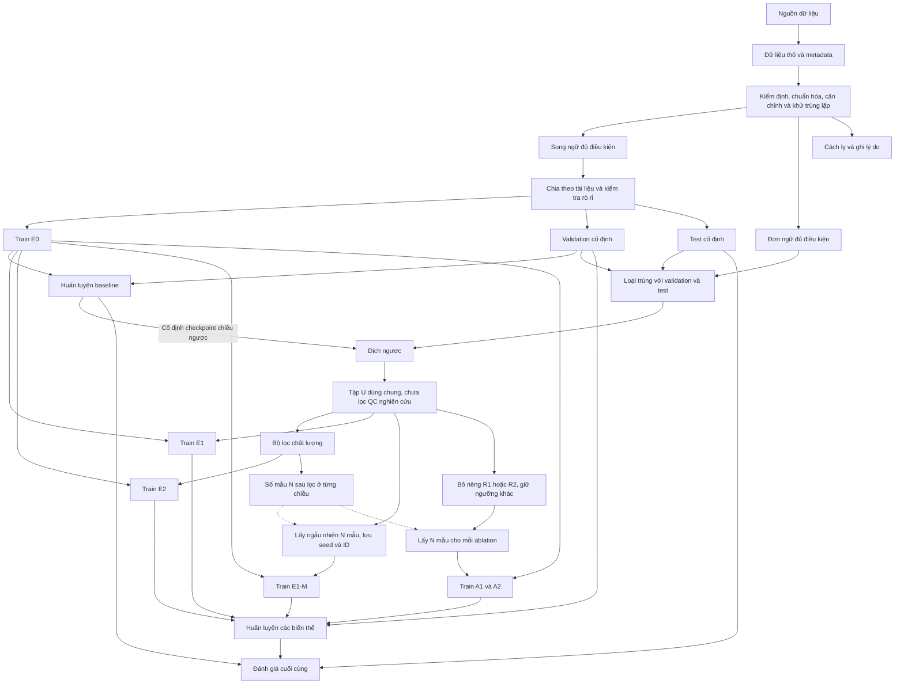
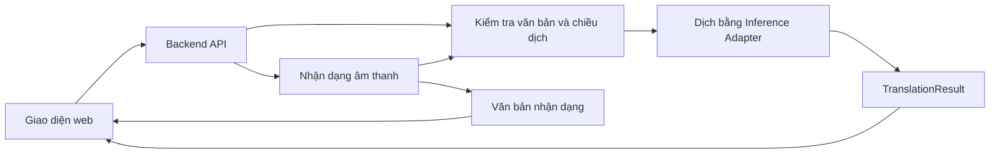

# Kiến trúc hệ thống

## Trạng thái thiết kế

Đã có phần lưu trữ, kiểm kê, trích xuất và công cụ làm sạch/chia dữ liệu trong `src/data_pipeline/`. Kiến trúc mô hình, tăng cường dữ liệu và ứng dụng bên dưới vẫn là **thiết kế dự kiến**. Pipeline huấn luyện và ứng dụng chưa triển khai.

Phạm vi và lựa chọn công nghệ còn mở nằm tại [PROJECT_CONTEXT.md](PROJECT_CONTEXT.md). Các điều kiện nghiệm thu nằm tại [PROJECT_REQUIREMENTS.md](PROJECT_REQUIREMENTS.md).

## Luồng dữ liệu và thực nghiệm



Validation dùng để chọn cấu hình/checkpoint; test dùng cho kiểm tra rò rỉ và đánh giá cuối cùng, không dùng để sinh mẫu huấn luyện. Dữ liệu thô giữ riêng; mỗi bước xử lý tạo đầu ra và thống kê để đối chiếu.

E1/E2/E1-M/A1/A2 dùng chung U, được sinh một lần từ mô hình E0 chiều ngược đã cố định. N là số mẫu E2 sau lọc ở từng chiều; đường nét đứt từ N biểu thị tham số số lượng. E1-M lấy ngẫu nhiên không hoàn lại N mẫu từ U để đối chứng với E2; A1/A2 cũng giữ N mẫu. Chọn R1/R2 từ dữ liệu phát triển trước test. Các biến thể huấn luyện giữ train gốc và cùng khởi tạo, không mặc định tiếp tục huấn luyện từ checkpoint E0. Quy định so sánh/ngân sách tại F06 và phần thực nghiệm của [yêu cầu dự án](PROJECT_REQUIREMENTS.md).

Back-translation cho chiều **Việt → Tày** dùng câu Tày đơn ngữ làm đích, dịch bằng mô hình **Tày → Việt** để tạo câu nguồn tổng hợp; chiều ngược lại làm tương tự. Phân biệt chiều của mô hình sinh dữ liệu với chiều mô hình được huấn luyện.

## Thành phần và trách nhiệm

| Thành phần dự kiến | Đầu vào | Đầu ra / trách nhiệm |
| --- | --- | --- |
| `src/data_pipeline/` | Nguồn công khai, tài liệu và dữ liệu nhập | Thu thập, audit, chuẩn hóa, căn chỉnh, khử trùng lặp, chia tập; chuẩn bị tokenizer nếu cần |
| `src/models/` | Cấu hình, tokenizer và dữ liệu train/validation | Huấn luyện, chọn checkpoint, suy luận theo chiều dịch |
| `src/augmentation/` | Mô hình sinh cố định và đơn ngữ đủ điều kiện | Tập U, quyết định lọc, E1/E2/E1-M/A1/A2, seed và ID mẫu |
| `src/evaluation/` | Checkpoint, test, cấu hình metric và kế hoạch chấm | Chỉ số hai chiều; cùng mẫu chấm ẩn tên hệ thống, thứ tự ngẫu nhiên, phiếu điểm gốc và phân tích lỗi |
| `src/web_app/` | Văn bản hoặc âm thanh từ người dùng | Kiểm tra đầu vào, gọi dịch/ASR và trả kết quả |
| `src/tests/` | Fixture nhỏ, cấu hình thử nghiệm | Kiểm tra pipeline, mô hình và tích hợp phù hợp với phần đã triển khai |

Các quy tắc QC dự kiến gồm độ dài đầu ra, tỷ lệ độ dài, sao chép nguồn, số liệu, lặp từ và dấu hiệu lẫn ngôn ngữ đích. Ngưỡng và ngoại lệ phải được kiểm tra trên validation, lưu trong cấu hình; không dùng heuristic làm bằng chứng duy nhất cho đúng/sai ngôn ngữ.

### Pipeline dữ liệu hiện có

| Script trong `src/data_pipeline/` | Vai trò và trạng thái |
| --- | --- |
| `crawl_vov4.py` | Thu thập có kiểm soát; đã kiểm thử parser/robots bằng fixture, chưa crawl lại trực tuyến |
| `build_vov_candidates.py`, `build_vov_sentences.py` | Trích xuất ứng viên; đã tái hiện và khớp byte với dữ liệu đối chiếu |
| `audit_data.py` | Tạo inventory, source registry và validation report mới; giữ registry đầu vào và snapshot ban đầu |
| `clean_dedup.py` | Kiểm tra duyệt theo nguồn/hash/số bản ghi rồi làm sạch; corpus hiện tại chưa có bản ghi được duyệt |
| `split_dataset.py` | Kiểm tra manifest làm sạch, gom nhóm tài liệu và câu trùng từng phía; đã kiểm thử, chưa chia corpus thật |
| `common.py` | Đọc JSONL, hash, ghi đầu ra không đè file có sẵn và manifest từng lần chạy |

Đầu vào raw giữ nguyên. Phê duyệt trong registry gắn với checksum và số thứ tự bản ghi, không dựa vào nhãn tự khai trong corpus. Khi khử trùng lặp, giữ mọi `source_records` và `source_documents`; khi chia tập, nối nhóm theo tài liệu hoặc câu trùng ở từng phía để tránh rò rỉ do mất thông tin tài liệu. Chưa có kiểm tra gần trùng tự động.

Lệnh và bằng chứng từng bước nằm tại [quy trình xây dựng dữ liệu](docs/QUY_TRINH_XAY_DUNG_DU_LIEU.md).

## Tổ chức lưu trữ

```text
configs/            # Cấu hình dữ liệu, mô hình và thực nghiệm
src/                # Các thành phần trong bảng trên
data/
  raw/              # Dữ liệu thô, giữ để đối chiếu
  interim/          # Kết quả trích xuất, căn chỉnh và kiểm định
  quarantine/       # Dữ liệu cách ly kèm lý do
  processed/        # Dữ liệu chuẩn hóa và các tập cố định
  augmented/        # Dữ liệu tổng hợp và biến thể QC
  manifests/        # Phiên bản, nguồn, số lượng và dấu vết xử lý
models/             # Checkpoint, tokenizer và cấu hình đi kèm
experiments/        # Cấu hình từng lần chạy, log, bản dịch và metric
docs/               # Đề cương, báo cáo và hướng dẫn chi tiết
reference/          # Tài liệu tham khảo
```

Chỉ tạo thư mục khi có nội dung cần quản lý. File lớn và dữ liệu không được phép chia sẻ cần có phương án lưu trữ riêng; mã nguồn dùng đường dẫn cấu hình thay vì gắn với một máy.

### Triển khai theo nhu cầu

- `raw/`, `interim/` và `manifests/` đã có dữ liệu đầu vào, ứng viên trích xuất và kết quả kiểm kê. Nhãn trong file thô được giữ nguyên; trạng thái xác minh hiện tại nằm trong `source_registry.json`.
- `processed/` sẽ được tạo khi có dữ liệu đã qua kiểm định. Chưa có tập train/validation/test chính thức; không tự lấy mọi JSONL dưới `data/` làm dữ liệu huấn luyện.
- `quarantine/` đã cần dùng ngay khi kiểm tra đầu vào: chứa `e1_backtranslation_rejected.jsonl`, gồm các bản dịch ngược có trạng thái `rejected_automatic`. Lý do theo bản ghi được giữ trong `quality_flags`; thống kê tại `validation_report.json`. Các cặp này chỉ phục vụ phân tích lỗi.
- `augmented/` sẽ được tạo khi triển khai sinh dữ liệu tăng cường. Dữ liệu nằm ở đây vẫn phải qua quy trình quyết định sử dụng, không tự trở thành dữ liệu vàng.
- Thư mục corpus và log crawl được `.gitignore` loại khỏi Git trong khi xác minh điều kiện sử dụng. Manifest được quản lý cùng tài liệu; chưa có cơ chế tải corpus khi clone repo.

### Manifest hiện có

| File | Nội dung |
| --- | --- |
| [inventory.json](data/manifests/inventory.json) | Snapshot, đường dẫn, SHA-256, kích thước, số bản ghi và trường dữ liệu của 12 file đầu vào/log |
| [source_registry.json](data/manifests/source_registry.json) | Metadata khai báo, bằng chứng kiểm tra nguồn, trạng thái kiểm duyệt và điều kiện sử dụng |
| [validation_report.json](data/manifests/validation_report.json) | Kiểm tra JSONL, trường dữ liệu, trùng cặp chính xác sau chuẩn hóa, nguồn tham chiếu và lý do cách ly |

Manifest là kết quả kiểm kê tại một thời điểm, không tự cập nhật khi file thay đổi. `audit_data.py` tạo bộ manifest mới trong output-dir riêng; không ghi đè quyết định kiểm duyệt hoặc snapshot ban đầu. Khi raw đổi hash, registry tạo lại đưa nguồn về trạng thái chưa duyệt. Hash không bao gồm bản thân manifest để tránh tham chiếu vòng. Các kiểm tra chưa thực hiện được liệt kê rõ trong báo cáo.

Lần tái hiện hiện có: `data/interim/replay-2026-11-01/` chứa bản kiểm tra của hai file ứng viên; `data/manifests/replay-2026-11-01/` lưu các lần chạy và kiểm kê lại. Đây không phải dữ liệu mới độc lập để tăng số mẫu.

## Quy ước dữ liệu và đầu ra

| Đối tượng | Thông tin tối thiểu dự kiến |
| --- | --- |
| Bản ghi dữ liệu | `id`, `source_doc_id`, nguồn/tài liệu gốc, `tay_text`, `vi_text`, cách tạo, trạng thái kiểm duyệt |
| Dữ liệu đơn ngữ | Một trường ngôn ngữ có nội dung; đánh dấu đơn ngữ, không tự coi là cặp song ngữ |
| Dữ liệu tổng hợp | Bản ghi nguồn, chiều sinh, model/tokenizer, cấu hình giải mã và lần chạy |
| Kết quả QC | ID bản ghi, phiên bản bộ lọc, chấp nhận/loại và danh sách lý do |
| Manifest tập dữ liệu | Phiên bản, số lượng, hash hoặc danh sách ID, quy tắc xử lý, seed và nhóm chia tập |
| Kết quả thực nghiệm | Run ID, cấu hình, phiên bản dữ liệu, checkpoint, môi trường, bản dịch, metric và log |

JSONL dự kiến dùng cho dữ liệu theo bản ghi; JSON dùng cho manifest và kết quả máy đọc. Khi chốt schema, bổ sung kiểm tra trường bắt buộc và khả năng truy ngược từ kết quả tới nguồn dữ liệu.

## Ứng dụng minh họa và Hợp đồng Giao tiếp Suy luận



React, FastAPI, PyTorch và Whisper là các công nghệ được nêu trong đề cương; phiên bản và cấu hình triển khai chưa chốt. Backend gọi thành phần suy luận dùng chung với đánh giá, không huấn luyện mô hình trong yêu cầu dịch.

### Hợp đồng Giao tiếp Suy luận (Inference Adapter Contract)

Nhánh `translation-pipeline` cung cấp bộ điều hợp suy luận `TranslationInferenceAdapter` (alias `InferenceAdapter`) và `MockTranslator` tại `src/models/inference_adapter.py` để nhánh `feat/web-demo` và bộ đánh giá tích hợp:

1. **Khởi tạo và Chế độ hoạt động:**
   ```python
   from src.models import TranslationInferenceAdapter, Direction, TranslationResult

   # Chế độ Mock phục vụ kiểm thử và demo khi chưa có checkpoint thật:
   engine = TranslationInferenceAdapter(mock_mode=True)

   # Chế độ Real nạp trọng số checkpoint thật (yêu cầu thư mục checkpoint hợp lệ):
   engine = TranslationInferenceAdapter(
       checkpoint_dir="models/checkpoints/checkpoint-best-E0",
       mock_mode=False,
   )
   ```

2. **Giao diện gọi dịch (Calling Conventions):**
   - Đơn câu: `engine.translate(text: str, direction: str | Direction = "vi-tyz") -> TranslationResult`
   - Đa câu (Batch): `engine.translate_batch(texts: list[str], direction: str | Direction = "vi-tyz") -> list[TranslationResult]`
   - Caller trong web-demo: `engine.translate(normalized_text, payload.direction)`

3. **Quy chuẩn Chiều dịch (Direction Aliases):**
   Bộ điều hợp tự động chuẩn hóa các biến thể chuỗi chiều dịch qua `Direction.normalize`:
   - Việt → Tày: `"vi-tyz"`, `"vi_to_tay"`, `"vi-tay"`, `"vi->ty"`, `Direction.VI_TO_TAY`
   - Tày → Việt: `"tyz-vi"`, `"tay_to_vi"`, `"tay-vi"`, `"ty->vi"`, `Direction.TAY_TO_VI`

4. **Cấu trúc Kết quả Trả về (`TranslationResult`):**
   | Trường | Kiểu dữ liệu | Ý nghĩa |
   | :--- | :--- | :--- |
   | `src_text` | `str` | Câu nguồn đã chuẩn hóa NFC và khoảng trắng |
   | `tgt_text` | `str` | Câu dịch đầu ra |
   | `direction` | `str` | Chiều dịch chuẩn hóa (`"vi-tyz"` hoặc `"tyz-vi"`) |
   | `model_version` | `str` | Tên/phiên bản checkpoint (e.g. `"mock-seq2seq-v1"` hoặc tên run) |
   | `latency_ms` | `float` | Thời gian xử lý suy luận tính bằng mili giây |
   | `status` | `str` | Trạng thái suy luận: `"ready"`, `"mock_mode"`, hoặc `"error"` |
   | `error_message` | `str | None` | Thông báo lỗi chi tiết nếu có |

   Hỗ trợ cả truy cập thuộc tính (`res.tgt_text`), truy cập dạng từ điển (`res["tgt_text"]`), `res.get("tgt_text")`, và tuần tự hóa `res.to_dict()`.

5. **Xử lý Ngoại lệ (Exceptions):**
   - `EmptyInputError`: Ném ra khi chuỗi đầu vào rỗng hoặc chỉ có khoảng trắng.
   - `TextTooLongError`: Ném ra khi chuỗi vượt quá độ dài tối đa cho phép (mặc định 2000 ký tự).
   - `InvalidDirectionError`: Ném ra khi chiều dịch không hợp lệ.
   - `ModelNotReadyError`: Ném ra khi gọi dịch lúc mô hình chưa khởi tạo thành công.
